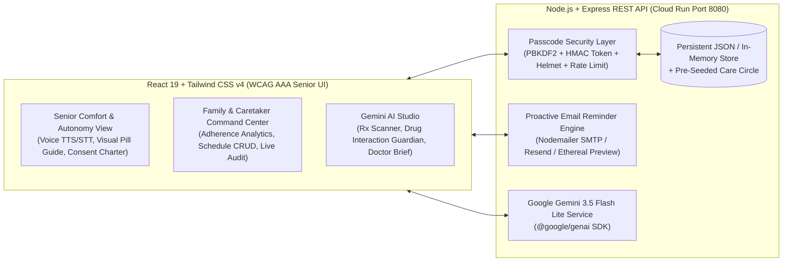

# KinCare AI — Smart Elderly Care & Medication Management Platform

> **Built for Google for Developers × Hack2Skill — PromptWars x Catalyst (Build with AI)**  
> *Keeping elderly individuals at the centre of their own healthcare decisions through a secure, passcode-protected Care Circle, proactive email escalations, and Google Gemini AI.*

---

## 🎯 Problem Statement Alignment Matrix

| Challenge Requirement | How KinCare AI Solves & Exceeds It |
| :--- | :--- |
| **Daily Medications, Medical Appointments & Healthcare Routines** | Unified timeline managing daily medication slots (Morning/Afternoon/Night), visual pill identifiers (color & shape), daily wellness routines (hydration, vitals, physiotherapy walks), and doctor appointments with `.ics` calendar exports. |
| **Shared Ecosystem with Secure Passcode-Based Access** | Role-aware **Welcome & Account Sign-Up / Login Portal** (`/api/auth/signup`, `/api/auth/verify-passcode`) using `PBKDF2-HMAC-SHA256` + constant-time verification + signed session tokens + rate-limiting for **Elderly Person (`123456`)**, **Family Member (`654321`)**, and **Caregiver (`112233`)**, plus custom account creation. |
| **View, Add, Edit, Manage Schedules & Track Adherence** | Full CRUD for medications, doctor appointments (Create/Edit/Delete + `.ics` calendar export), vitals, and daily routines (Add/Toggle/Delete), real-time pill stock alerts, and a 7-day adherence analytics chart. |
| **Proactive Email Reminders (Missed Meds, Upcoming Doses, Appointments)** | **Hybrid Proactive Email Engine** (Resend Live Email API, SMTP, Nodemailer Ethereal Sandbox, and Live HTML Email Outbox Inspector) with a **Live 9:00 AM Auto-Escalation Watcher** that sends AI-enriched alerts to the Care Circle (`ALERT_EMAIL_RECIPIENT`). |
| **Beyond a Basic Reminder App — Elderly at the Centre of Decisions** | **1. GrandPad/Medisafe-Inspired 4-Screen Senior View** (*1. My Medicines* with spotlight card & Undo, *2. My Day & Doctor* with 1-tap emoji mood check-in, *3. Voice Helper*, *4. Choices & SOS*)<br>**2. Elder Decision & Autonomy Charter** (Family/Caregiver proposes schedule changes via Command Mode; Elderly person approves/declines in 1 tap)<br>**3. Google Gemini 3.5 Flash Lite Prescription Scanner & Drug-Food Interaction Guardian**<br>**4. Multilingual AI Care Companion & Voice Reminder Broadcaster, Intelligent Caregiver Alerts & Pre-Visit Doctor Brief**<br>**5. One-Tap Emergency SOS & Printable QR Medical ID Card** |

---

## 🏗️ System Architecture



---

## 🚀 Quick Start (Local Development)

### 1. Install Dependencies
```bash
npm install
```

### 2. Configure Environment (Optional — Works Out-of-the-Box!)
Copy `.env.example` to `.env`:
```bash
cp .env.example .env
```
*Note: The platform includes pre-seeded Care Circle demo profiles, an intelligent clinical fallback engine alongside `@google/genai`, and a Hybrid Live Email Outbox Inspector so every feature works immediately for judges without requiring external keys.*

### 3. Run in Development or Production Mode
```bash
# Development (hot-reload API + Vite UI)
npm run dev

# Or Production Build & Serve locally on Port 8080
npm run build
npm start
```
- **Local Production App:** Open `http://localhost:8080` in Chrome/Edge (use `localhost` rather than `0.0.0.0` on Windows).
- **Development UI:** `http://localhost:5173`
- **Backend API & Health Check:** `http://localhost:8080/api/health`

### 4. Run Automated Test Suite
```bash
npm test
```

---

## 🔑 Demo Passcodes & Custom Account Sign-Up

Users can either create their own account from the **Welcome / Sign Up** screen or sign in with pre-seeded roles:

| Care Circle Member | Role | Demo Passcode | Key Capabilities |
| :--- | :--- | :--- | :--- |
| **Ramesh Sharma (74 yrs)** | `elder` (Elderly Person) | **`123456`** | Opens **4-Screen Senior View** (*My Medicines*, *My Day & Doctor*, *Voice Helper*, *Choices & SOS*) |
| **Priya Sharma** | `family` (Family Member) | **`654321`** | Full **Family Command Center**, medication/appointment/routine CRUD, vitals, consent proposals, proactive emails |
| **Nurse Anita Rao** | `caretaker` (Caregiver) | **`112233`** | Clinical schedule management, vitals logging, AI Drug Interaction, Prescription Scanner & Doctor Brief |

---

## ☁️ Production Deployment Guidelines (Google Cloud Run, Render, Vercel)

> Never commit your local `.env` file (`GEMINI_API_KEY`, `RESEND_API_KEY`) to GitHub—`.gitignore` excludes it automatically. Instead, set environment variables directly in your hosting provider:
> - `GEMINI_API_KEY` (from Google AI Studio)
> - `GEMINI_MODEL=gemini-3.5-flash-lite`
> - `RESEND_API_KEY` (from Resend)
> - `ALERT_EMAIL_RECIPIENT=9553943884pavan@gmail.com`
> - `SESSION_SECRET` (random long string)

### Option A: Google Cloud Run (Recommended for Top 10 Qualification)
```bash
gcloud auth login
gcloud config set project YOUR_GCP_PROJECT_ID

gcloud run deploy kincare-ai-platform \
  --source . \
  --region asia-south1 \
  --allow-unauthenticated \
  --port 8080 \
  --set-env-vars "NODE_ENV=production,GEMINI_MODEL=gemini-3.5-flash-lite,ALERT_EMAIL_RECIPIENT=9553943884pavan@gmail.com,GEMINI_API_KEY=YOUR_KEY,RESEND_API_KEY=YOUR_RESEND_KEY,SESSION_SECRET=YOUR_SECRET"
```

### Option B: Render (One-Click via `render.yaml`)
1. Push your code to a public GitHub repository.
2. In Render Dashboard → **New + → Blueprint** (or Web Service) and connect your repo.
3. Render reads `render.yaml` (`npm install && npm run build` and `npm start` on Port `8080`, health check `/api/health`).
4. Add `GEMINI_API_KEY`, `GEMINI_MODEL=gemini-3.5-flash-lite`, `RESEND_API_KEY`, `ALERT_EMAIL_RECIPIENT`, and `SESSION_SECRET` under **Environment**.

### Option C: Vercel (`vercel.json` + `api/index.js`)
```bash
npx vercel --prod
```
Add the same environment variables in Vercel Project Settings → **Environment Variables** and redeploy.

### Docker Build & Run
```bash
docker build -t kincare-ai-platform .
docker run -p 8080:8080 --env-file .env kincare-ai-platform
```

---

## 🧪 Automated Code Assessment Signals Covered
- **Code Quality & Modularity:** Clean ES module separation (`server/security`, `server/services`, `server/data`, `src/components`), Zod schema validation.
- **Security Practices:** `helmet` HTTP headers, `express-rate-limit` brute-force protection, salted `PBKDF2-HMAC-SHA256` passcode hashing with `crypto.timingSafeEqual`.
- **Effective Use of Google Services:** Official `@google/genai` SDK (`gemini-3.5-flash-lite` with multi-model Gemini 3 cascade), Cloud Run containerization (`Dockerfile`, `cloudbuild.yaml`, `/api/health`).
- **Accessibility:** Semantic HTML5, ARIA live regions, adjustable font scaling (`A` / `A+` / `A++`), High Contrast mode, and native Web Speech API Text-to-Speech & Speech Recognition.
- **Testing:** Automated API integration test suite (`tests/api.test.js`) powered by `vitest` and `supertest`.
