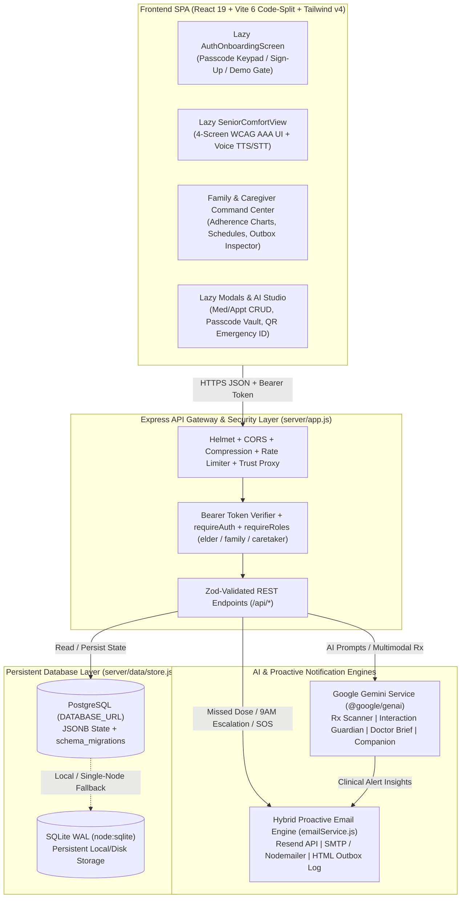

# KinCare AI — Smart Elderly Care & Medication Management Platform

> **Live Deployed App:** https://kincare-72je.onrender.com  
> **Live Health & Telemetry Endpoint:** https://kincare-72je.onrender.com/api/health  
> **GitHub Repository:** https://github.com/9553943884pavan-alt/KinCare  
> **Hackathon Track:** CATALYST Solo AI Hackathon — Makers Need More (MnM) × PromptWars (*Build with AI*)

KinCare AI is a full-stack, role-based elderly care and medication coordination platform built to keep elderly individuals at the centre of their own healthcare decisions while connecting family members and caregivers through real-time adherence tracking, proactive email escalations, and Google Gemini AI.

---

## 📋 Table of Contents
1. [Problem Statement](#-problem-statement)
2. [Our Solution & Alignment Matrix](#-our-solution--alignment-matrix)
3. [How We Use Google Technologies](#-how-we-use-google-technologies)
4. [Tech Stack](#-tech-stack)
5. [Main Architecture Diagram](#-main-architecture-diagram)
6. [Key Features Implemented](#-key-features-implemented)
7. [Security, Privacy & RBAC Architecture](#-security-privacy--rbac-architecture)
8. [Automated Tests & Quality Verification](#-automated-tests--quality-verification)
9. [Run Locally (Step-by-Step Commands)](#-run-locally-step-by-step-commands)
10. [Production Deployment (Render & Google Cloud Run)](#-production-deployment-render--google-cloud-run)

---

## 🔍 Problem Statement

Managing daily healthcare for elderly individuals often breaks down across three real-world gaps:

1. **Medication Complexity & Missed Doses:** Seniors managing polypharmacy (multiple daily tablets across morning, afternoon, evening, and night slots) face pill confusion, dosing errors, drug-drug or food interactions, and unmonitored refills.
2. **Fragmented Caregiver Coordination:** Family members and nurses often rely on disconnected text messages or paper notes, leaving missed doses, vitals changes, and doctor appointment preparations unnoticed until an emergency occurs.
3. **Loss of Elder Autonomy & Inaccessible UIs:** Most health apps overwhelm seniors with cluttered small-text dashboards or let relatives silently alter schedules without the elderly person's consent.

---

## 💡 Our Solution & Alignment Matrix

KinCare AI replaces fragmented reminders with a **shared, passcode-protected Care Circle ecosystem** backed by **PostgreSQL (`JSONB`) / SQLite WAL persistence**, **Google Gemini AI (`@google/genai`)**, and a **role-adaptive interface** that separates a distraction-free **WCAG AAA Senior Comfort View** from a comprehensive **Family & Caregiver Command Center**.

| Challenge Requirement | How KinCare AI Solves It |
| :--- | :--- |
| **Daily Medications, Appointments & Healthcare Routines** | Unified timeline managing daily medication slots (`Morning` / `Afternoon` / `Evening` / `Night`), visual pill identifiers (color & shape), pill stock/refill alerts, daily wellness routines (Add / Complete / Delete), vitals/mood logging, and doctor appointments with one-click `.ics` calendar exports. |
| **Shared Ecosystem with Secure Passcode-Based Access** | Role-aware authentication (`/api/auth/verify-passcode`, `/api/auth/signup`, plus explicit Demo-Mode-gated `/api/auth/demo-login`) using salted `PBKDF2-HMAC-SHA256`, `crypto.timingSafeEqual`, HMAC-signed Bearer session tokens, rate limiting, and role-based access control (**Elderly Person**, **Family Member**, **Caregiver**). |
| **View, Add, Edit, Manage Schedules & Track Adherence** | Full CRUD API and UI for medications, appointments, daily routines, and vitals; automatic stock deduction on dose confirmation (`taken`) and stock restoration on Undo; 7-day adherence analytics bar chart and downloadable CSV compliance reports. |
| **Proactive Email Reminders (Missed Doses, Upcoming Doses, Appointments)** | Hybrid proactive escalation engine (`server/services/emailService.js`) integrating **Resend API**, **SMTP / Nodemailer**, Ethereal preview, and an interactive **Live HTML Email Outbox Inspector**, triggered automatically on missed doses, scheduled auto-scans, and the **9:00 AM Missed Dose Detector**. |
| **Beyond a Basic Reminder App — Elderly at the Centre of Decisions** | **1. 4-Screen Senior Comfort View** (*My Medicines* spotlight card with Undo, *My Day & Doctor* with 1-tap mood check-in, *Voice Helper*, *Choices & SOS*)<br>**2. Elder Autonomy & Consent Charter** (Relatives propose changes; only the `elder` role can approve/decline)<br>**3. Google Gemini 3.5 Flash Lite Studio** (Rx Scanner, Drug-Food Interaction Guardian, Pre-Visit Doctor Brief, Caregiver Alert Enrichment, Multilingual Care Companion)<br>**4. One-Tap Emergency SOS & Printable QR Emergency Medical ID Card** |

---

## 🧠 How We Use Google Technologies

### 1. Google Gemini AI (`@google/genai` SDK)
Implemented in [server/services/geminiService.js](server/services/geminiService.js) using the official `GoogleGenAI` client with a resilient Gemini 3 model cascade (`gemini-3.5-flash-lite` primary $\rightarrow$ `gemini-3.1-flash-lite` $\rightarrow$ `gemini-3.6-flash` $\rightarrow$ `gemini-3.8-flash` $\rightarrow$ `gemini-3-flash-preview`) and clinical fallback handling:

1. **Multimodal AI Prescription Scanner (`POST /api/ai/scan-prescription`):** Extracts structured medications, dosages, frequencies, time slots, and meal instructions from pasted prescription text or uploaded prescription images (`inlineData` base64 multimodal input).
2. **Drug-Drug & Drug-Food Interaction Guardian (`POST /api/ai/interactions`):** Cross-checks all active medications against the elder's diagnosed conditions and allergies to return an overall clinical safety score, severity alerts, and food/timing guidance.
3. **Intelligent Caregiver Alert Enrichment (`generateIntelligentCaregiverAlert`):** Triggered whenever a dose is marked `missed` or via the **9:00 AM Missed Dose Detector**, combining recent vitals and medication context into actionable guidance embedded inside outgoing Care Circle emails.
4. **Pre-Visit Doctor Brief Generator (`POST /api/ai/doctor-brief`):** Synthesizes 7-day medication adherence, recent vitals trends, low-stock flags, and pending elder questions into a printable consultation brief.
5. **Multilingual AI Care Companion (`POST /api/ai/companion`):** Answers medication and appointment questions in **English, Hindi, or Telugu**, paired with browser Speech-to-Text (`STT`) and Text-to-Speech (`TTS`).

### 2. Google Cloud Run & Container Readiness
- Containerized multi-stage production build in [Dockerfile](Dockerfile) (`node:24-alpine`, port `8080`, Docker `HEALTHCHECK` against `/api/health`).
- Automated Cloud Build pipeline in [cloudbuild.yaml](cloudbuild.yaml) targeting managed Cloud Run (`asia-south1`).
- Live telemetry endpoint `GET /api/health` verifying database initialization, security flags, `@google/genai` configuration, and email readiness.

---

## 💻 Tech Stack

| Layer | Technologies |
| :--- | :--- |
| **Frontend** | React 19 (`react`, `react-dom`), Vite 6, Tailwind CSS v4 (`@tailwindcss/vite`), Lucide Icons (`lucide-react`), Web Speech API (TTS & Voice Input) |
| **Backend API** | Node.js `>=22.5.0` (ES Modules), Express 4 (`express`), Zod 4 (`zod`) runtime validation, `compression` |
| **AI & Notifications** | Official Google Gemini SDK (`@google/genai`, `gemini-3.5-flash-lite`), Resend HTTPS API, Nodemailer (`nodemailer`) |
| **Persistent Database** | **PostgreSQL (`pg`)** (`JSONB` state + `schema_migrations`) & built-in **SQLite WAL (`node:sqlite` `DatabaseSync`)** fallback/local mode |
| **Security & Hardening** | `PBKDF2-HMAC-SHA256` (`node:crypto` + `timingSafeEqual`), HMAC-SHA256 signed Bearer session tokens, `helmet`, `express-rate-limit`, `cors`, role RBAC middleware |
| **Testing & Quality** | Vitest 5 (`vitest`), Supertest 7 (`supertest`), Node syntax linting (`node --check`) |
| **Deployment** | Render (`render.yaml` + Managed PostgreSQL), Docker, Google Cloud Run (`cloudbuild.yaml`) |

---

## 🏗️ Main Architecture Diagram



---

## ✨ Key Features Implemented

- **4-Screen WCAG AAA Senior Comfort View ([src/components/SeniorComfortView.jsx](src/components/SeniorComfortView.jsx)):**
  - *1. My Medicines:* Large spotlight card for the next due dose with pill color/shape badges, **"Hear Aloud"** voice readout, 1-tap **"I Took It"**, and **"Undo"** (which restores pill inventory automatically).
  - *2. My Day & Doctor:* 1-tap emoji mood/comfort check-in (`vitalsLog`), simple daily routine toggles, and an input for seniors to save questions for upcoming doctor appointments.
  - *3. Voice Helper:* Hands-free bilingual voice prompt and speech companion powered by Web Speech API + Gemini AI.
  - *4. Choices & SOS:* Elder Consent approval cards, Personal Autonomy sharing preferences, and a One-Tap Emergency SOS dispatch button.
- **Elder Autonomy & Consent Charter:** Family members or caregivers can *propose* medication or routine adjustments via the Command Center, while API-level RBAC (`requireRoles('elder')`) guarantees only the Elderly Person can approve or decline them.
- **Family & Caregiver Command Center ([src/App.jsx](src/App.jsx)):**
  - Role-switchable workspace with 5 tabs: **Care Circle Overview**, **Medication Schedule**, **Appointments & Routines**, **Proactive Emails**, and **Gemini AI Studio**.
  - Interactive 7-day adherence analytics chart, CSV compliance export, `.ics` calendar export, Care Circle email notification toggles (`Missed Med`, `Upcoming`, `Visits`), and live audit trail (`activityFeed`).
- **Proactive Email Escalation Engine & Live Outbox Inspector ([server/services/emailService.js](server/services/emailService.js)):**
  - Dispatches HTML emails with escaped inputs (`escapeHtml`) via Resend or SMTP when medications are missed, scanned automatically, escalated via **Simulate 9:00 AM Missed Dose**, or triggered from **Emergency SOS**.
- **Printable QR Emergency Medical ID Card ([src/components/Modals.jsx](src/components/Modals.jsx)):** Displays blood group, allergies, active medications, primary physician, and emergency contacts in a print-ready medical ID modal.
- **Optimized Production Bundle:** Forced production React transforms inside [vite.config.js](vite.config.js), Rollup `manualChunks` (`vendor-react`, `vendor-icons`, `vendor`), and route/modal `React.lazy()` code splitting reduced the initial entry JS chunk by **82.4%** (`740.49 kB` $\rightarrow$ `130.14 kB`; `176.05 kB` $\rightarrow$ `22.16 kB` gzip).

---

## 🔒 Security, Privacy & RBAC Architecture

Implemented in [server/security/passcodeAuth.js](server/security/passcodeAuth.js) and [server/app.js](server/app.js):

1. **Zero Plaintext Credential Leaks:** `GET /api/public-members` returns only public directory metadata (no `demoPasscodeHint`, `passcodePlainHint`, or `passcodeHash`), and all user creation/profile responses pass through `sanitizeMemberPayload`.
2. **Cryptographic Passcode Verification & Session Signing:** Passcodes are salted and hashed with `PBKDF2-HMAC-SHA256` (`10,000` iterations) and verified using constant-time comparison (`crypto.timingSafeEqual`). Sessions use HMAC-SHA256 signed Bearer tokens with 24-hour expiration.
3. **Strict Endpoint Authentication & Role Authorization:**
   - Every mutating and AI `/api/*` endpoint requires a valid Bearer token resolved against an active member in the Care Circle (`requireAuth`).
   - `PATCH /api/autonomy/:id` enforces `requireRoles('elder')`.
   - `POST` / `DELETE /api/care-circle/members*`, `PUT /api/elder-profile`, and `PUT /api/elder-profile/autonomy` enforce `requireRoles('elder', 'family')`.
4. **Unauthenticated PHI Protection:** `GET /api/dashboard` redacts `elderProfile`, `medications`, `vitalsLog`, `appointments`, `careCircleMembers`, and logs unless `req.user` is verified (`authRequired: true`).
5. **Production-Safe Demo Gating & Secret Validation:** `isDemoModeEnabled()` defaults to `false` when `NODE_ENV=production` unless `DEMO_MODE=true` is explicitly configured; `'000000'`, `/api/auth/demo-login`, and `/api/reset-demo` return `403`/`401` when demo mode is off. `validateProductionSecret()` rejects empty or weak placeholder secrets when `DEMO_MODE=false`.

---

## 🧪 Automated Tests & Quality Verification

Test suite in [tests/api.test.js](tests/api.test.js) powered by **Vitest** and **Supertest** (`16/16` passing tests):

- **Health & Database Readiness:** Verifies `/api/health` database status, security flags, and Google Gemini service metadata.
- **Passcode Authentication & Signup Flows:** Tests `elder`, `family`, and `caretaker` passcode logins, invalid PIN rejections (`401`), and new account registration without exposing password hashes or plaintext hints.
- **Care Circle CRUD & Clinical Logic:** Validates medication create/take/undo/delete stock sync, missed-dose automatic email dispatch, 9:00 AM escalation simulation, appointment editing, routine deletion, XSS HTML escaping in emails, non-numeric vitals sanitization, and JSON `404` handling.
- **AI Studio Endpoints:** Tests prescription extraction, drug interaction scoring, and multilingual care companion replies.
- **Security & Persistence Regressions:**
  - Asserts `/api/public-members` never exposes `demoPasscodeHint`/`passcodePlainHint` and unauthenticated `/api/dashboard` withholds PHI.
  - Asserts unauthenticated mutating calls return `401` and unauthorized roles (`caretaker` on autonomy/care-circle/profile endpoints) return `403`.
  - Validates `validateProductionSecret` rejects weak/missing production secrets and verifies `DEMO_MODE=false` blocks `/api/auth/demo-login`, `'000000'`, and `/api/reset-demo`.
  - Simulates process restarts via `reopenDatabaseForTest()` on a temporary disk SQLite WAL file to confirm mutations survive server restarts.

---

## 🚀 Run Locally (Step-by-Step Commands)

**Prerequisites:** Node.js `>=22.5.0` (tested on Node `v24.18.0`) and npm.

### 1. Clone the Repository & Install Dependencies
```bash
git clone https://github.com/9553943884pavan-alt/KinCare.git
cd KinCare
npm install
```

### 2. Configure Environment Variables
```bash
# macOS / Linux
cp .env.example .env

# Windows PowerShell
Copy-Item .env.example .env
```
Works out of the box locally using SQLite WAL (`server/data/kincare.sqlite`) and hybrid email preview; optionally fill `GEMINI_API_KEY`, `RESEND_API_KEY`, `DATABASE_URL`, and `SESSION_SECRET` in `.env` (generate a strong secret with `node -e "console.log(require('crypto').randomBytes(32).toString('hex'))"`).

### 3. Start Development Mode (Hot-Reload Backend + Vite UI)
```bash
npm run dev
```
- **Frontend UI:** `http://localhost:5173`
- **Backend API & Health Check:** `http://localhost:8080/api/health`

### 4. Run Production Build & Serve Locally
```bash
npm run build
npm start
```
- **Production App:** `http://localhost:8080` *(use `http://localhost:8080` in your browser on Windows)*

### 5. Run Linting & Automated Test Suite
```bash
# Syntax check all server modules
npm run lint

# Run all 16 Vitest + Supertest integration & security regression tests
npm test
```

---

## ☁️ Production Deployment (Render & Google Cloud Run)

### Option A: Render (`render.yaml` Blueprint or Web Service)
1. Push your repository to GitHub (`main` branch).
2. In Render Dashboard $\rightarrow$ **New + $\rightarrow$ Blueprint** (or **Web Service**), connect `KinCare`.
3. [render.yaml](render.yaml) configures `npm install --include=dev && npm run build`, `npm start`, health check `/api/health`, `NODE_ENV=production`, `ENFORCE_SESSION_SECRET="true"`, `DEMO_MODE="false"`, and an auto-generated `SESSION_SECRET`.
4. Attach a Render **PostgreSQL** database (`DATABASE_URL` Internal URL) for persistent multi-instance storage, and set `GEMINI_API_KEY`, `GEMINI_MODEL=gemini-3.5-flash-lite`, `RESEND_API_KEY`, and `ALERT_EMAIL_RECIPIENT`. *(Set `DEMO_MODE=true` only if hosting a public judge evaluation demo with 1-tap role cards).*

### Option B: Google Cloud Run
```bash
gcloud auth login
gcloud config set project YOUR_GCP_PROJECT_ID

gcloud run deploy kincare-ai-platform \
  --source . \
  --region asia-south1 \
  --allow-unauthenticated \
  --port 8080 \
  --set-env-vars "NODE_ENV=production,ENFORCE_SESSION_SECRET=true,DEMO_MODE=false,GEMINI_MODEL=gemini-3.5-flash-lite,ALERT_EMAIL_RECIPIENT=YOUR_EMAIL,GEMINI_API_KEY=YOUR_KEY,RESEND_API_KEY=YOUR_RESEND_KEY,SESSION_SECRET=YOUR_SECRET,DATABASE_URL=YOUR_POSTGRES_URL"
```

### Option C: Docker
```bash
docker build -t kincare-ai-platform .
docker run -p 8080:8080 --env-file .env kincare-ai-platform
```
